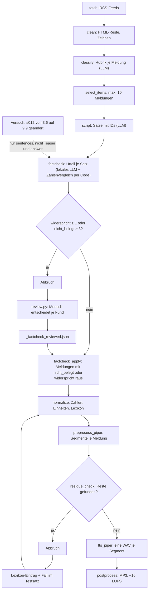

# Versuch: Fact-Check findet eine falsche Zahl

## Rahmen

- **Datum:** 2026-11-02
- **Lauf:** `2026-11-02_1001`
- **Profil:** `news_classify`
- **Prüfer:** `qwen/qwen3.6-35b-a3b`, lokal über LM Studio, dazu der Code-Prüfer `apply_number_check`
- **Zweck:** Fertig-Kriterium Phase 2. Eine absichtlich falsche Zahl muss vom Fact-Check gefunden werden und darf nicht in der MP3 landen.
- **Pipeline:** siehe README und Grafik unten

Der Versuch läuft in einem eigenen, neuen Lauf. Ältere Läufe bleiben unverändert, damit sie als Beleg erhalten bleiben.

## Workflow

Prüfende Stufen (Rauten) halten an, verändernde Stufen führen aus. Zwischen Urteil und Ausführung liegt immer eine Datei.

## Ablauf

1. **Ausgangslauf:** `python run.py --profile news_classify`. Abbruch in `residue_check` mit einem Fund (Kürzel BP). BP ins Lexikon, Fall `t032` in den Testsatz, dann `--from normalize`. Ergebnis: 33 Sätze, 17 Segmente, davon 10 Meldungen. Satz `s012` aus Meldung `m001` mit der Zahl 3,6: Urteil `belegt`, `by: llm`.
2. **Manipulation:** In `_script.json` nur unter `sentences` bei `s012` die Zahl 3,6 durch 9,9 ersetzt. Der Teaser in `items` (Quelle) und die Rohantwort in `answer` blieben unverändert. Damit ist der Eingriff in der Datei selbst nachweisbar.
3. **Fact-Check:** `--from factcheck --run 2026-11-02_1001`
4. **Review:** `python src\review.py --run 2026-11-02_1001`, Entscheidung `drop`, eigene Begründung als Testfall vermerkt
5. **Ausführung:** `--from factcheck_apply --run 2026-11-02_1001`

## Vorhersage und Ergebnis

| | Vorhersage | Ergebnis |
|---|---|---|
| Urteil s012 | `widerspricht` | `widerspricht` ✓ |
| Prüfer | `llm` | `llm` ✓ |
| Wo wird reagiert | `factcheck_apply` wirft m001 raus | **`factcheck` stoppt den Lauf** ✗ |
| Sätze bei `normalize` | 30 | 30 ✓ |
| Segmente | 16 | 16 ✓ |

Die Begründung des Prüfers nennt beide Zahlen: Die Quelle spricht von 3,6 Milliarden, nicht von 9,9.

**Prüfung der Ausgabe:** MP3 um 12:44 neu geschrieben, also nach dem Review. In `_normalize.json` 30 Sätze, davon 0 aus `m001`. Suche nach dem Firmennamen der Meldung und nach „neun Komma neun“: kein Treffer. Die falsche Zahl ist nicht in der MP3.

## Erkenntnis

**Belegt durch den Versuch:**

1. Der lokale Prüfer hat die geänderte Zahl in diesem Fall selbst erkannt. Der Code-Prüfer musste nicht eingreifen.
2. Ein einziges `widerspricht` stoppt den ganzen Lauf schon in `factcheck`, nicht erst in `factcheck_apply`. Prüfen und Ausführen sind getrennt: Die Prüfstufe hält an, ein Mensch entscheidet, erst dann führt `factcheck_apply` aus. An dieser Stelle lag die Vorhersage falsch.
3. Grund für die Strenge: Eine nachprüfbar falsche Tatsache stellt das ganze Skript infrage, nicht nur den einen Satz.

**Nicht belegt:**

- Die Aussagekraft ist begrenzt: ein Fall, ein Modell, ein Fehlertyp.
- Ob kleine Ausschmückungen („umgehend“, „vollständig entschädigt“) erkannt werden, wurde nicht getestet.

## Nebenbefund: Testsatz

Der Testsatz war seit dem Umbau von `normalize` in Phase 2 nicht mehr lauffähig. Das Format stand noch auf `items` mit `title` und `teaser`, und im Profil `testsatz_piper` fehlte `preprocess_piper`. Beides umgestellt: 35 Sätze, 33 Segmente, 0 Funde. Neu im Testsatz: `t032` (BP), `t033` (FIRE).

## Offen

- Erste Überleitung „Und nun zur …“ direkt nach der Begrüßung
- Aussprache „Parteispitze“ (sp im zusammengesetzten Wort)
- Testsatz als pytest, damit er nicht wieder still bricht
- Weitere Fehlertypen: Ausschmückung, falscher Name, falsches Datum
