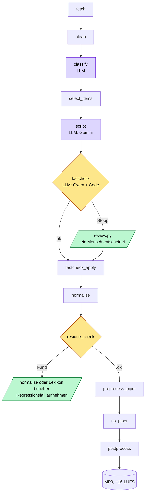

# tts_audio

[English](README.md) | **Deutsch**


tts_audio ist eine Python-Pipeline, die aktuelle Schlagzeilen und Teaser aus RSS-Feeds in ein hörbares Nachrichten-Briefing verwandelt. Ein Sprachmodell schreibt das Skript, ein zweites, lokales Modell prüft jeden Satz gegen die Quelle, und Code prüft die Zahlen. Eine Restprüfung stoppt den Lauf, sobald im Text noch Ziffern, Abkürzungen oder Sonderzeichen stehen, die die Stimme falsch vorlesen würde.

Das Projekt ist ein Lernprojekt in Arbeit. **Phase 1 und 2 sind fertig:** Ein Befehl macht aus den aktuellen Feeds ein geprüftes Briefing als MP3 mit lokaler Sprachausgabe über Piper. **Als Nächstes kommt Phase 3:** dasselbe Skript, vertont mit Gemini TTS.

## Pipeline



Gelbe Stufen prüfen nur und verändern nie Text. Lila Stufen nutzen ein Sprachmodell. Grüne Schritte erledigt ein Mensch.

Drei Grundsätze gelten für jede Stufe:

- **Eine Aufgabe pro Stufe.** Prüfende und verändernde Stufen sind getrennt.
- **Entscheidung und Ausführung hinterlassen getrennte Spuren.** `factcheck` urteilt nur, `factcheck_apply` streicht nur. Dazwischen liegt eine Datei, und ein menschliches Urteil wird als eigene Datei gespeichert.
- **Fertig heißt:** Die Datei der Stufe existiert und ihr Status ist ok. Auch eine Stufe, die stoppt, schreibt eine Datei mit Grund.

## Stufen

| Stufe | Eine Aufgabe |
|---|---|
| fetch | Schlagzeilen und Teaser aus RSS-Feeds holen |
| clean | HTML-Reste entfernen, Anführungs- und Bindestriche vereinheitlichen, Leerzeichen ordnen |
| classify | jede Meldung einer Kategorie zuordnen; Rauschen wird markiert |
| select_items | Rauschen aussortieren, die neuesten brauchbaren Meldungen behalten |
| script | ein LLM schreibt kurze, hörgerechte Sätze; Begrüßung, Quellenzeile und KI-Kennzeichnung kommen vom Code, die Satz-IDs auch |
| factcheck | jeden Satz gegen die Quelle beurteilen: belegt, nicht belegt, widerspricht; Code vergleicht die Zahlen |
| factcheck_apply | streichen, was das Urteil sagt; liest das menschliche Urteil, wenn es eins gibt |
| normalize | Text vorlesbar machen: Zahlen, Datum, Uhrzeit, Einheiten, Zeichen, Lexikon; runden nur, wo eine Whitelist es erlaubt |
| residue_check | übrige Ziffern, Kürzel, Zeichen und URLs finden; jeder Fund stoppt den Lauf |
| preprocess_piper | ein Segment pro Meldung für die Stimme |
| tts_piper | eine WAV pro Segment mit Piper |
| postprocess | Segmente mit Gong verbinden, Lautheit auf −16 LUFS, eine MP3 schreiben |

Ein Widerspruch wird nie vertont. Zu viele unbelegte Sätze stoppen den Lauf vor `factcheck_apply` (Schwelle im Profil). Getestet wurde der Fact-Check mit einer absichtlich falschen Zahl im Skript: Sie wurde als Widerspruch erkannt, der Lauf stoppte, und die Zahl kam nicht in der MP3 an.

## Schnellstart (Windows, PowerShell)

Voraussetzungen: Python 3.11, [ffmpeg](https://ffmpeg.org/) im PATH (zum Beispiel `winget install Gyan.FFmpeg`), eine deutsche Piper-Stimme, ein Gemini-API-Key und [LM Studio](https://lmstudio.ai/) mit einem Qwen-Modell für den Fact-Check.

```powershell
git clone https://github.com/Martin-Frei/tts_audio.git
cd tts_audio
python -m venv .venv
.venv\Scripts\Activate.ps1
python -m pip install -r requirements.txt
Copy-Item .env.example .env
```

In `.env` den `GEMINI_API_KEY` eintragen. Die Stimme `de_DE-thorsten-high` von den [offiziellen Piper-Stimmen](https://github.com/OHF-Voice/piper1-gpl/blob/main/docs/VOICES.md) laden und beide Dateien (`.onnx` und `.onnx.json`) nach `voices/` legen. Stimmen sind Modelldateien, keine Python-Pakete, und liegen nicht im Repository.

Den Server in LM Studio starten, dann die ganze Pipeline:

```powershell
python run.py --profile news_classify
```

Nur Phase 1, ohne Sprachmodell:

```powershell
python run.py --profile news_piper
```

## Läufe und Wiedereinstieg

Jeder Lauf bekommt einen eigenen Ordner in `data/runs/news/<run_id>/`; die run_id ist die Startzeit (`JJJJ-MM-TT_HHMM`). Jede Stufe legt dort ihr Ergebnis ab, und ein Laufzettel hält Profil, Parameter und fertige Stufen fest.

Stoppt eine Stufe, die Ursache beheben und ab dieser Stufe neu starten:

```powershell
python run.py --profile news_classify --from normalize
```

Stoppt der Fact-Check, prüft ein Mensch die Funde mit `src/review.py`, danach geht der Lauf ab `factcheck_apply` weiter:

```powershell
python run.py --profile news_classify --from factcheck_apply
```

## Konfiguration

| Datei | Inhalt |
|---|---|
| `config/pipelines.yaml` | Profile: Stufen, Reihenfolge, Modelle, Einstellungen |
| `config/feeds.yaml` | RSS-Feeds |
| `config/rundung_whitelist.json` | welche Zahlen gerundet werden dürfen, und wie |
| `config/aussprache_lexikon.json` | Aussprache von Namen und Kürzeln |
| `prompts/` | Prompts für Skript und Fact-Check, getrennt vom Code |

Das Lexikon wächst aus echten Daten: Jeder Fund der Restprüfung wird einmal behoben und als Regressionsfall in den Testsatz aufgenommen.

## Tests

```powershell
python -m pip install -r requirements-dev.txt
python -m pytest --doctest-modules src tests
```

117 Tests: Kleine Funktionen werden mit doctest im Docstring getestet (56), Stufen mit pytest und temporären Ordnern (61). Kein Test nutzt das Internet, ein Sprachmodell oder die echten Konfigurationsdateien. Ein fester Testsatz läuft durch die echten Stufen und wird nach jeder Änderung an normalize, Lexikon oder Stimme mit dem Ohr geprüft.

## Fahrplan

1. **Piper:** holen und lokal vorlesen. *Fertig.*
2. **Hörskript:** ein LLM schreibt das Skript, ein zweites Modell prüft es gegen die Quellen, bei einem Stopp entscheidet ein Mensch. *Fertig.*
3. **Gemini TTS:** dasselbe Skript in höherer Qualität, im Vergleich mit Piper. *Als Nächstes.*
4. **Stiltests:** wie Stil-Anweisungen Tempo und Ton verändern, gemessen. *Geplant.*
5. **Docker Compose und Podcast-Feed.** *Geplant.*

## Hinweise

- Verwendet werden nur Titel und Teaser, nie ganze Artikel. Briefings aus fremden Nachrichten bleiben privat und werden nicht veröffentlicht.
- Jedes Briefing sagt, dass es mit KI erstellt wurde.
- Die Lizenzen von Piper (GPL-3.0) und der Stimme werden vor einer Veröffentlichung des Repositorys geprüft.
- Die Stufen-Dokumente sind datierte Momentaufnahmen und zeigen den Stand ihres Tages. Den aktuellen Stand beschreibt diese README.

Dokumentation der einzelnen Stufen: `A_documentation/doku_public/`.
