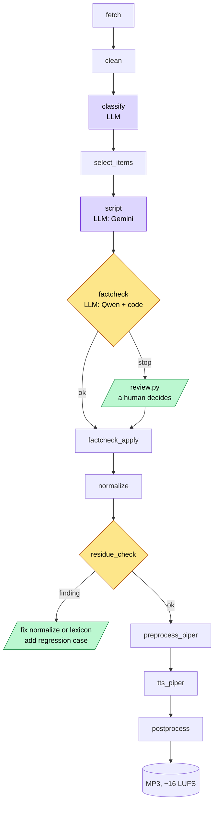

# tts_audio

**English** | [Deutsch](README.de.md)


tts_audio is a Python pipeline that turns current headlines and teasers from RSS feeds into a spoken news briefing. One language model writes the script, a second, local model checks every sentence against its source, and code checks the numbers. A residue check stops the run as soon as the text still contains digits, abbreviations or symbols the voice would read out wrongly.

This is a learning project in progress. **Phases 1 and 2 are done:** one command turns the current feeds into a fact-checked briefing as an MP3 with local speech from Piper. **Next up is phase 3:** the same script voiced with Gemini TTS.

## Pipeline



Yellow stages only check, they never change text. Purple stages use a language model. Green steps are done by a human.

Three principles hold for every stage:

- **One task per stage.** Checking stages and changing stages are separate.
- **Decision and execution leave separate traces.** `factcheck` only judges, `factcheck_apply` only removes. A file lies between them, and a human verdict is saved as its own file.
- **Done means:** the stage's file exists and its status is ok. A stage that stops also writes a file with the reason.

## Stages

| Stage | One task |
|---|---|
| fetch | download headlines and teasers from RSS feeds |
| clean | remove HTML remains, unify quotes and hyphens, tidy whitespace |
| classify | sort each item into a category; noise is marked |
| select_items | drop noise, keep the newest usable items |
| script | an LLM writes short spoken sentences; greeting, source line and AI label come from code; sentence IDs from code |
| factcheck | judge every sentence against its source: supported, not supported, contradicts; code compares the numbers |
| factcheck_apply | remove what the verdict says; reads the human verdict if one exists |
| normalize | make text speakable: numbers, dates, times, units, symbols, lexicon; round only where a whitelist allows it |
| residue_check | find digits, abbreviations, symbols and URLs that are left; any finding stops the run |
| preprocess_piper | one segment per item for the voice |
| tts_piper | one WAV per segment with Piper |
| postprocess | join the segments with a gong, set loudness to −16 LUFS, write one MP3 |

A contradiction is never voiced. Too many unsupported sentences stop the run before `factcheck_apply` (threshold set in the profile). The fact check was tested with a deliberately wrong number in the script: it was flagged as a contradiction, the run stopped, and the number did not reach the MP3.

## Quick start (Windows, PowerShell)

Requirements: Python 3.11, [ffmpeg](https://ffmpeg.org/) on the PATH (for example `winget install Gyan.FFmpeg`), a German Piper voice, a Gemini API key and [LM Studio](https://lmstudio.ai/) with a Qwen model for the fact check.

```powershell
git clone https://github.com/Martin-Frei/tts_audio.git
cd tts_audio
python -m venv .venv
.venv\Scripts\Activate.ps1
python -m pip install -r requirements.txt
Copy-Item .env.example .env
```

Enter your `GEMINI_API_KEY` in `.env`. Download the voice `de_DE-thorsten-high` from the [official Piper voices](https://github.com/OHF-Voice/piper1-gpl/blob/main/docs/VOICES.md) and put both files (`.onnx` and `.onnx.json`) into `voices/`. Voices are model files, not Python packages, and are not part of the repository.

Start the LM Studio server, then run the full pipeline:

```powershell
python run.py --profile news_classify
```

Phase 1 alone, without any language model:

```powershell
python run.py --profile news_piper
```

## Runs and restarts

Every run gets its own folder in `data/runs/news/<run_id>/`; the run_id is the start time (`YYYY-MM-DD_HHMM`). Each stage writes its result there, and a run manifest records profile, parameters and finished stages.

If a stage stops, fix the cause and restart from that stage:

```powershell
python run.py --profile news_classify --from normalize
```

If the fact check stops, a human reviews the findings with `src/review.py`, then the run continues from `factcheck_apply`:

```powershell
python run.py --profile news_classify --from factcheck_apply
```

## Configuration

| File | Content |
|---|---|
| `config/pipelines.yaml` | profiles: stages, order, models, settings |
| `config/feeds.yaml` | RSS feeds |
| `config/rundung_whitelist.json` | which numbers may be rounded, and how |
| `config/aussprache_lexikon.json` | pronunciation of names and abbreviations |
| `prompts/` | prompts for script and fact check, kept out of the code |

The lexicon grows from real data: every finding of the residue check is fixed once and added to the test sentence set as a regression case.

## Tests

```powershell
python -m pip install -r requirements-dev.txt
python -m pytest --doctest-modules src tests
```

117 tests: small functions are tested with doctest in their docstrings (56), stages with pytest and temporary folders (61). No test uses the internet, a language model or the real configuration files. A fixed test sentence set runs through the real stages and is checked by ear after every change to normalize, lexicon or voice.

## Roadmap

1. **Piper:** fetch and speak locally. *Done.*
2. **Briefing script:** an LLM writes the script, a second model checks it against the sources, a human decides when it stops. *Done.*
3. **Gemini TTS:** the same script in higher quality, compared with Piper. *Next.*
4. **Style tests:** how style prompts change tempo and tone, measured. *Planned.*
5. **Docker Compose and podcast feed.** *Planned.*

## Notes

- Only titles and teasers are used, never full articles. Briefings from third-party news stay private and are not published.
- Every briefing says it was made with AI.
- Licences of Piper (GPL-3.0) and of the voice are still to be checked before the repository is made public.
- The stage documents are dated snapshots of their day. This README describes the current state.

Documentation of each stage: `A_documentation/doku_public/` (German).
